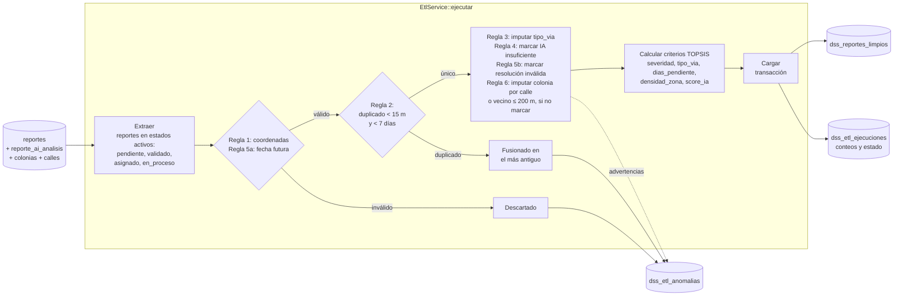

# Proceso ETL: módulo DSS

> Proyecto Integrador · Desarrollo de Software para la Toma de Decisiones (DSTD)

El ETL prepara los datos de los reportes ciudadanos antes del análisis multicriterio TOPSIS.
**Solo lee** la tabla `reportes` (nunca la modifica) y escribe en las tablas `dss_*`.

Implementación: `app/Services/Dss/EtlService.php` (métodos `extraer()`, `transformar()` y `cargar()`).

## Flujo



Si ocurre un error, la transacción de carga se revierte, la ejecución queda como `fallido` y el
mensaje se guarda en `dss_etl_ejecuciones.mensaje_error` y en el log de Laravel.

## Cómo ejecutarlo

```bash
# 1. Crear las tablas dss_* (solo la primera vez)
php artisan migrate

# 2. (Opcional) Cargar datos sucios simulados para demostrar las reglas
php artisan db:seed --class=DatosSuciosSeeder

# 3. Ejecutar el ETL
php artisan dss:etl

# 4. Pruebas automatizadas de las reglas
php artisan test tests/Feature/Dss
```

También se puede ejecutar desde la interfaz: **Priorización → pestaña "Calidad de datos" →
Ejecutar ETL**, o por API:

| Método | Ruta | Descripción |
|---|---|---|
| `GET` | `/api/dss/etl/ultima` | Última ejecución con conteos por tipo de anomalía |
| `GET` | `/api/dss/etl/anomalias?ejecucion_id=&tipo=&severidad=` | Anomalías paginadas, con folio del reporte |
| `POST` | `/api/dss/etl/ejecutar` | Ejecuta el ETL y devuelve el resumen |

Todas requieren autenticación (`auth:sanctum`).

Cada ejecución crea un registro nuevo en `dss_etl_ejecuciones`. El historial de ejecuciones
anteriores se conserva.

## Datos simulados

`DatosSuciosSeeder` inserta 20 reportes marcados como simulados (folio `SIM-XXXX` y descripción que
empieza con `[DATO SIMULADO]`). No se incluye en `DatabaseSeeder`.

| Folios | Caso | Resultado esperado |
|---|---|---|
| SIM-0001 – 0004 | Reportes correctos (control) | Cargados sin anomalías |
| SIM-0005 – 0008 | Coordenadas en 0,0, en CDMX y fuera del límite municipal | Descartados |
| SIM-0009 – 0012 | Dos pares de duplicados (~5 m y ~8 m, 1–2 días de diferencia) | 0010 y 0012 fusionados |
| SIM-0013 – 0014 | `tipo_via` nulo (con calle avenida / sin calle) | Imputados (`avenida_principal` / `calle_secundaria`) |
| SIM-0015 – 0016 | Sin análisis IA / confianza 30 | Marcados, `datos_suficientes = false` |
| SIM-0017 – 0018 | Fecha de reporte futura | Descartados |
| SIM-0019 – 0020 | Resolución anterior al reporte | Marcados |

## Regla 6: colonia faltante

Cuando `colonia_id` es nulo, el ETL intenta, en orden:

1. **Calle asociada:** si el reporte tiene `calle_id` y esa calle tiene colonia, se usa esa colonia.
2. **Vecino más cercano:** se busca el reporte limpio más cercano con colonia **original** a
   ≤ 200 m (`RADIO_IMPUTACION_COLONIA_M`). Las colonias imputadas en la misma ejecución no se usan
   como referencia, para no encadenar imputaciones.
3. **Sin referencia:** el reporte se carga con `colonia_id = NULL` ("Sin colonia") y la anomalía
   se registra como `marcado`.

En los casos 1 y 2 la acción es `imputado` y `regla_aplicada` indica de dónde salió la colonia.
La imputación solo vive en `dss_reportes_limpios`. En el indicador de concentración, "Sin colonia"
no compite en el top 5 y se reporta aparte.

## Ejemplo de salida real

Ejecución sobre la base de demostración (17 reportes activos del `DemoDataSeeder`) más los 20
reportes de `DatosSuciosSeeder`, con las 6 reglas:

```text
$ php artisan dss:etl
Ejecutando ETL del módulo DSS…

Ejecución #3 · 2026-11-19 17:19:13
+---------------------------+--------+
| Métrica                   | Valor  |
+---------------------------+--------+
| Registros leídos          | 37     |
| Registros cargados        | 29     |
| Registros descartados     | 6      |
| Registros con advertencia | 12     |
| Tasa de calidad           | 78.4 % |
+---------------------------+--------+
+------------------------+----------+
| Tipo de anomalía       | Cantidad |
+------------------------+----------+
| duplicado              | 2        |
| coordenada_fuera_rango | 4        |
| tipo_via_faltante      | 2        |
| sin_analisis_ia        | 2        |
| fecha_invalida         | 4        |
| campo_faltante         | 6        |
+------------------------+----------+
```

Lectura:
- De 37 reportes leídos, 6 se descartaron (4 por coordenadas y 2 por fecha futura) y 2 se
  fusionaron como duplicados, así que se cargaron 29 (37 − 6 − 2).
- Las 6 anomalías `campo_faltante` corresponden a reportes **reales** de la demo sin colonia. Ninguno
  se pudo imputar: no tienen calle asociada y el reporte con colonia más cercano está a entre 258 m
  y 1.2 km. Por eso quedaron marcados como "Sin colonia".
- Las demás anomalías provienen de los datos simulados (`SIM-`).
